# 上证 50 逐笔数据微观结构深度研究报告

**样本**：上证 50 成分股 50 只 · 交易日 2026-09-23 · 上交所 Level-2 逐笔 + 3 秒快照
**数据规模**：逐笔委托 6,276,360 条（新增 4,533,409 / 撤单 1,742,701）· 逐笔成交 3,792,934 条（含集合竞价 38,867）· 行情快照 252,631 条 · 全日成交额 **972.5 亿元**
**研究定位**：本文不做撮合还原（那是"交易所复现"任务），而是**把这批数据当作真实的市场显微切片**，系统性刻画流动性、波动、订单流、订单行为、成交特征与跨股票联动，并回答若干可检验的微观结构命题。

---

## 0. 结论速览（TL;DR）

1. **日内节律是"双 U 形 + 午间断点"**。价差、波动、成交量、撤单在开盘瞬间同时冲高（波动 z≈+4.1、价差 z≈+3.5），随后单调衰减；午间（11:00–13:30）最清淡；尾盘再度抬头。**深度与波动严格反向**：开盘最薄、午后最厚。（图 2）
2. **流动性横截面被"价格档位"主导**：相对价差与股价相关系数 **−0.83**。低价股（华电新能 25.3 bp、中国联通 23.7 bp）受 0.01 元最小变动价位约束，价差被"顶"得很宽；高价股（茅台 2.5 bp、兆易创新 1.1 bp）相对价差极窄，但**跳动点数很多**（茅台买一价差 18.5 跳）。（图 11）
3. **订单流不平衡（OFI）是价格的"同期强信号、预测弱信号"**：同期 OFI 可解释 3 秒中价收益方差的 **14.2%**；但对未来收益的预测力仅 0.4%–0.5% 并随视野衰减——**A 股顶端大盘股在秒级上接近有效**。（图 3）
4. **越靠近盘口，预测越强**：买一失衡变化的预测 R²（3 秒）为 **3.1%**，是十档失衡变化（1.4%）的两倍；但**十档失衡的预测力随视野上升**（60 秒时反超短期），说明盘口压力是"快变量"、深档失衡是"慢变量"。（图 10）
5. **大单冲击以永久成分为主**：主动大单（各股前 1%）成交瞬间中价平均跳 **+4.4 bp**，300 秒后仍余 **+4.0 bp**（约 90% 永久、10% 临时）；但用中位数看则是"冲高后回吐"（+0.8→+2.5→+1.1 bp），**收益分布的重尾使均值与中位呈现不同的冲击-恢复画像**。（图 4）
6. **盘口持续偏向买盘**：买一侧挂单比卖一侧厚约 **+11%**（买一）/ **+22%**（五档内），且低价大盘股（中国联通、华电新能、中国铝业）买盘堆积最极端。（图 5）
7. **撤单是"远单快撤"战术**：贴中间价的订单撤单率仅 26.8%，而离中间价 20 跳以上的订单撤单率高达 **64.7%** 且中位存活仅 **11 秒**——典型的"占位/试探后快速撤单"。（图 6）
8. **跨股票联动高度同步但板块块状明显**：50 只里 39 只相对等权市场因子的最优领先滞后为 **0 分钟**（无稳定领先关系）；板块内相关显著（保险 0.72、券商 0.65、石油石化 0.63、通信 0.59、白酒 0.55、银行 0.47），并出现防御（煤炭电力）与周期（机械/消费）的负相关。（图 8）
9. **集合竞价占比小但尾盘强于早盘**：开盘竞价占全日成交额 0.59%，**收盘竞价 1.06%**（约为开盘的 1.8 倍），体现尾盘资金调仓意愿。（图 9）
10. **快照与逐笔在总量上高度自洽**：全日累计成交量（快照口径）／逐笔成交求和 = **99.94%**；区间级偏差主要来自约 0.15–1.0 秒的行情网关对齐偏移。（图 9）
11. **价差约六成是"逆向选择"**：有效价差均值 6.77 bp = 实现价差 2.80 bp + 价格冲击 3.97 bp，**冲击约占 59%**；Kyle λ 中位约 28 bp/百万股。且**波动升高并不带来更高撤单率**（撤单率在波动中位最高），拆单迹象明显（相邻委托同向概率 66%，远高于随机的 50%）。

---

## 1. 数据基础与字段确认

三张表：`ord`（逐笔委托）、`exe`（逐笔成交）、`snp`（3 秒十档快照）。研究前先做了语义校验：

| 校验项 | 结果 | 含义 |
| --- | --- | --- |
| 撤单记录能否对回新增委托 | **100%** | `OrderKind=68` 记录通过 `(Symbol, Channel, OrderOriNo)` 完全对上一条新增委托 |
| 撤单价格与原委托价格一致 | **100%** | 撤单语义确认无误 |
| 撤单量与新增委托量相等 | **98.35%** | 存在 1.65% 的**部分撤单** |
| 撤单时间不早于委托时间 | 100% | 时间轴自洽 |
| `ord` 委托量整手（100 股倍数）占比 | **94.6%** | 整手偏好强，散股来自零股/竞价 |

字段语义（与"交易所复现"任务结论一致）：`FunctionCode` 66/83 = 买/卖方向；`OrderKind` 65/68 = 新增/撤单；`exe.BSFlag` 66/83 = 主动买/主动卖、0 = 集合竞价成交；`Time` 为 `HHMMSSmmm` 整数。**上交所逐笔委托只披露"进入订单簿"的委托**（下单即全成的不出现），这决定了本文所有"委托行为"统计只覆盖挂单部分，需要在解读时记住。

---

## 2. 日内节律：U 形、午间断点与"最后一分钟的异动"

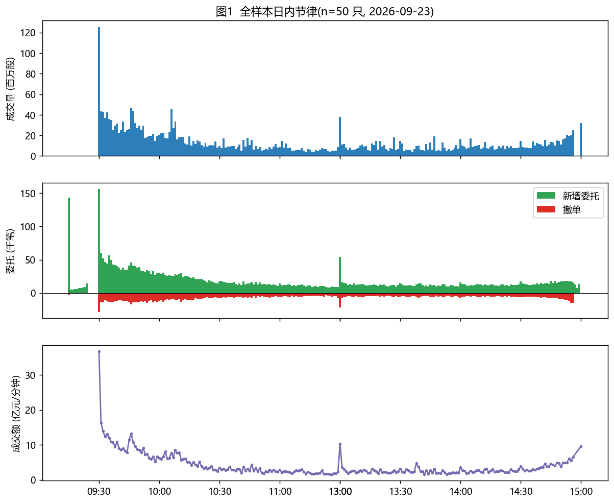

**图 1** 给出全样本的分钟内成交量、委托（新增/撤单）与成交额。两点很直观：开盘 09:30 第一分钟成交量约占全日的 6%–8%；午休前（11:30）与尾盘各有一个小峰。

为去掉个股量纲差异，把每只股票的分桶指标先做**自身 z 标准化**再横截面平均，得到"普适日内曲线"：

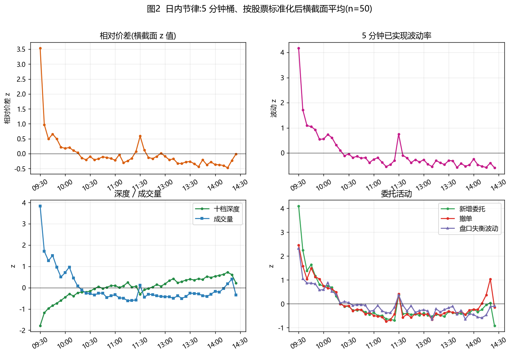

| 时段 | 相对价差(z) | 波动(z) | 十档深度(z) | 成交量(z) | 新增委托(z) | 撤单(z) |
| --- | ---: | ---: | ---: | ---: | ---: | ---: |
| 09:30 | **+3.51** | **+4.08** | −1.49 | **+3.87** | **+4.09** | +2.44 |
| 10:00 | +0.35 | +0.53 | −0.39 | +0.73 | +0.76 | +0.76 |
| 11:00 | −0.07 | −0.26 | +0.09 | −0.32 | −0.35 | −0.44 |
| 13:30 | +0.01 | −0.28 | +0.16 | −0.41 | −0.37 | −0.41 |
| 14:50 | −0.23 | −0.40 | +0.61 | +0.40 | +0.04 | **+1.04** |

**读法**：

- **价差**：开盘 +3.5σ，前 30 分钟迅速收敛到 0 附近，全天保持"开高—盘中平—尾盘微升"的弱 U 形。
- **波动**：开盘 +4.1σ 是全天最高点，之后单调下行，午间最低；**11:30 出现一个显著小峰**（午休前抢跑），尾盘再抬升。
- **深度**：与波动严格反向——开盘最薄（−1.5σ），一路增厚到午后 +0.6σ。**"开盘薄而躁、午后厚而静"是这批大盘股最稳的日内结构。**
- **委托活动**：新增与撤单同相，开盘冲高、午间最冷。**14:50 撤单 z 单独冲到 +1.0**，是尾盘调仓/改单的信号。

> 方法说明：只取 09:30–11:30 与 13:00–14:57 连续竞价区间，剔除 14:57–15:00 收盘集合竞价（其盘口行为与连续竞价不可比，见第 9 节）。

---

## 3. 流动性横截面：最小变动价位如何"顶住"低价股

对每只股票计算时间加权相对价差、有效价差、十档深度、已实现波动与 Amihud 非流动性：

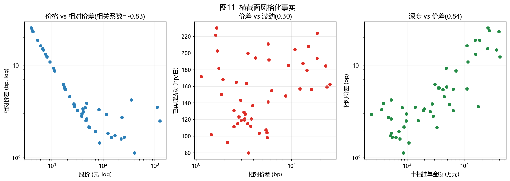

| 结论 | 证据 |
| --- | --- |
| 相对价差由股价主导 | corr(log 股价, log 相对价差) = **−0.83** |
| 波动与价差关系弱 | corr(log 价差, log 波动) = **+0.30** |
| "深度 vs 价差"呈**正**相关（反直觉） | corr = **+0.84**：深度大的恰是低价、高价差的股票 |

**原因**：A 股最小变动价位固定为 0.01 元。对 5 元股票，1 跳 = 20 bp；对 300 元股票，1 跳 = 0.33 bp。于是账面出现"两极化"：

| 类型 | 代表 | 相对价差 | 买一价差(跳) | 说明 |
| --- | --- | ---: | ---: | --- |
| 低价宽价差 | 华电新能 / 中国联通 / 中国建筑 | 25.3 / 23.7 / 23.0 bp | ≈1 跳 | 价差几乎是"一格"，但一格就值 20+ bp |
| 高价窄价差 | 兆易创新 / 贵州茅台 / 寒武纪 | 1.13 / 2.50 / 3.50 bp | 6.0 / 18.5 / 41.7 跳 | 相对价差极窄，但盘口跨度很大 |

**有效价差**（成交价相对中间价）与报价价差高度一致：茅台有效价差 18.3 跳 ≈ 报价 18.5 跳，说明**成交几乎全部发生在盘口、价格冲击极小**；而低价股有效价差 ≈1 跳同样说明成交"贴盘口"。这批标的的**执行成本主要是价差，而不是冲击**。

---

## 4. 订单流不平衡（OFI）：同期强、预测弱

采用 Cont–Kukanov–Stoikov (2014) 的 OFI 定义（买一侧有效增量 − 卖一侧有效增量），并辅以成交侧"主动净额"（主动买额 − 主动卖额）。逐股回归后取平均：

| 特征 | 关系 | 平均 R² | 平均斜率 |
| --- | --- | ---: | ---: |
| OFI(t) | **同期**中价收益 | **14.2%** | 8.8e-5 |
| 主动净额(t) | **同期**中价收益 | 12.6% | 8.2e-5 |
| OFI(t) | 预测 3 秒 | 0.43% | 1.3e-5 |
| OFI(t) | 预测 9 秒 | 0.51% | 2.3e-5 |
| OFI(t) | 预测 30 秒 | 0.35% | 2.5e-5 |
| OFI(t) | 预测 60 秒 | 0.20% | 2.4e-5 |
| 主动净额(t) | 预测 3 秒 | 0.72% | 1.8e-5 |
| 主动净额(t) | 预测 9 秒 | 0.63% | 2.8e-5 |

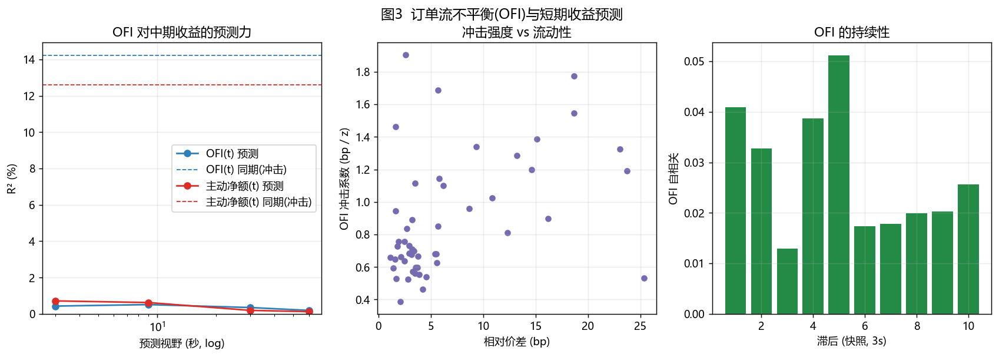

**要点**：

- **同期 R²≈14%** 说明订单流与价格在秒级上是"同一枚硬币的两面"（价格冲击）；而**预测 R² 只有 0.2%–0.7%**，且随视野衰减。对这批最流动的大盘股，**用 OFI 做秒级方向预测几乎没有可交易空间**。
- **成交侧的"主动净额"比盘口 OFI 预测力略强**（0.72% vs 0.43%，3 秒），与文献中"成交比挂单更信息"的经验一致。
- **OFI 自相关极低**（1–10 个快照滞后的自相关仅 0.01–0.05）。订单流在秒级近似白噪声——**没有可利用的"订单流动量"**。

---

## 5. 大单冲击与恢复：永久冲击为主，但重尾掩盖了回吐

对每只股票取成交量前 1% 的成交作为"大单"，做事件研究：以成交前一刻的中间价为基准，累计（已乘主动方向）中价收益。

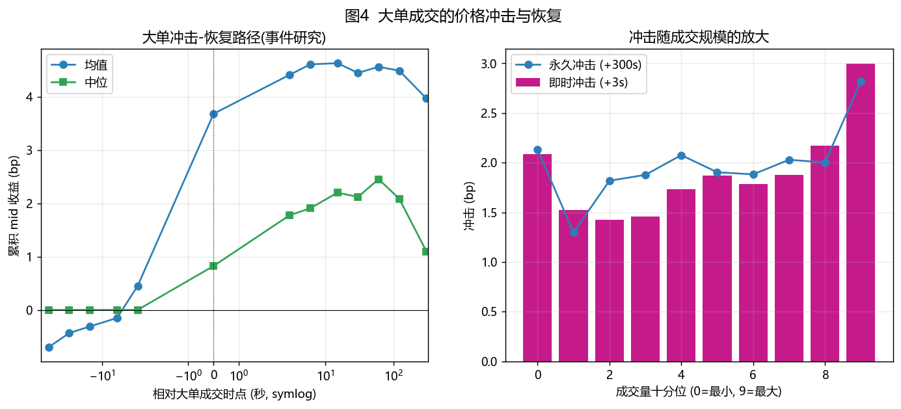

| 相对大单时点 | −60s | −3s | 0s | +3s | +15s | +60s | +300s |
| --- | ---: | ---: | ---: | ---: | ---: | ---: | ---: |
| **均值 (bp)** | −0.70 | +0.45 | +3.68 | **+4.41** | +4.63 | +4.56 | **+3.97** |
| **中位 (bp)** | 0.00 | 0.00 | +0.82 | +1.78 | +2.20 | +2.45 | **+1.10** |

**两种读法给出不同的"冲击结构"**：

- **均值口径**：即时冲击 +4.4 bp，300 秒后仍留 +4.0 bp → **约 90% 是永久冲击，仅 10% 回吐**。
- **中位口径**：即时 +0.8 bp，60 秒见顶 +2.5 bp，300 秒回落到 +1.1 bp → **约 55% 是临时冲击**。

重尾（少数"真正的大单"）把均值拉成"永久"，而典型大单其实**一半以上是暂时的流动性补偿**。此外，成交前 60 秒中价已偏离 −0.7 bp（均值为负 = 逆着大单方向走了），**说明大额主动买单常出现在价格刚被打压之后**（"逢跌扫货"的微观证据）。

**冲击随规模放大**（十分位）：最小档约 2.1 bp、最大档约 **3.0 bp**，并不呈指数爆炸——再次印证盘口厚、价格冲击可控。

> 注意：这里测的是**成交价对中间价的偏离**（已含半个价差 + 真实冲击），因此"最小档 2 bp"里大部分是买卖价差本身。

---

## 6. 订单簿形态与价格离散化偏好

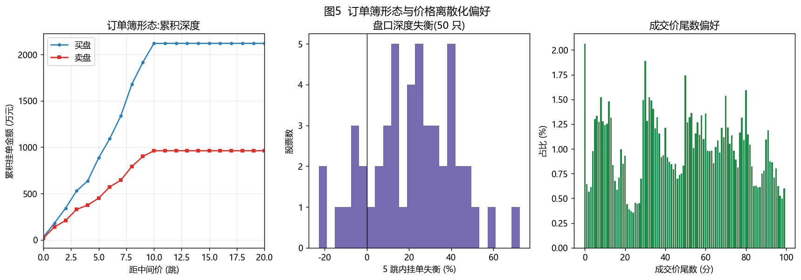

**（1）深度-距离曲线**：横截面中位意义上，累积挂单金额随距中间价的跳数快速上升，买十档累计约 **1,900 万元**、卖十档约 **960 万元**（中位），10 跳内已累积了绝大部分深度。

**（2）买卖深度不对称**：**买盘持续更厚**——买一/卖一失衡均值 **+10.8%**，五档内 **+21.5%**。极端者为中国联通、华电新能、中国铝业（五档内失衡 +37%~+45%），而邮储银行、国泰海通、中国船舶为卖盘更厚。这一偏向在本样本中稳定存在，可能与当日权重股偏多的资金结构有关。

**（3）价格取整与尾数偏好**：成交价落在 0.1 元整数倍上的比例 **14.9%**、0.5 元 **3.9%**、1.0 元 **2.1%**；尾数为"00 分"的成交占 **2.06%**（均匀分布应为 1%），"50 分"占 1.74%。**存在约 2 倍的整数价位堆积，但强度温和**——A 股 0.01 元的最小价位已经足够细，整数偏好主要停留在"角/元"级别。

---

## 7. 订单行为与撤单战术

| 指标 | 全样本 | 逐股区间 | 解读 |
| --- | ---: | ---: | --- |
| 主动（穿价）单占比 | 13.5% | 2.9%–49.3% | 绝大多数是限价挂单 |
| 撤单率 | **39.3%** | 24.9%–77.0% | 撤单是主流行为 |
| 闪电单（<3 秒撤）占新单 | 6.2% | 1.0%–31.9% | 存在"挂—撤"试探 |
| 委托存活中位时间 | ~24–35 秒 | 3–300 秒 | 大量委托活不过一集 K 线 |
| 委托规模中位 | 300 股 | 100–1500 股 | 整手为主（94.6%） |

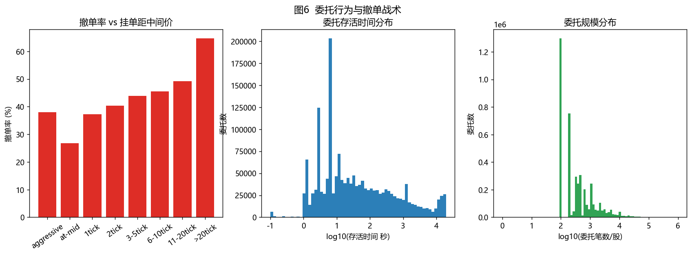

**"远单快撤"是这个样本里最干净的战术信号**：

| 挂单相对中间价 | 主动(穿价) | 贴中间价 | 1 跳 | 3–5 跳 | 11–20 跳 | **>20 跳** |
| --- | ---: | ---: | ---: | ---: | ---: | ---: |
| 撤单率 | 38.0% | **26.8%** | 37.3% | 43.9% | 49.2% | **64.7%** |
| 存活中位(秒) | 6.0 | 44.7 | 39.0 | 49.7 | 50.2 | **11.1** |

**贴中间价的订单撤得最少（26.8%）**——它们真想在价差内成交；**远离盘口的订单撤得最多（64.7%）且寿命最短（11 秒）**——更像"占位/施压后迅速改价"的算法行为。撤单率随距离单调上升，是本文对"远程撤单更快"假说的直接支持。

---

## 8. 成交特征、VPIN 与交易强度的日内衰减

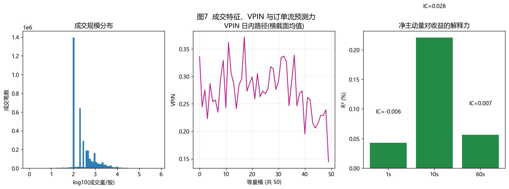

- **成交规模**：中位成交 200–280 股；**成交量前 1% 的成交贡献约 20% 的总成交量**（Top1VolShare 均值 0.20），集中度中等偏高。
- **成交方向**：主动买占 **48.7%**（略偏卖），逐股 36%–59%。
- **VPIN（50 个等量桶）**：样本均值 **0.27**（区间 0.13–0.53），且**日内呈缓慢下行**（开 0.30→ 收 0.22），即"知情交易强度"随时间衰减，与波动率的日内下行一致。
- **1 秒净主动量 → 未来收益**：IC 在 1 秒 ≈ 0、10 秒 ≈ +0.028、60 秒 ≈ +0.007，R² 均 < 0.25%。**再次确认秒级预测极弱**。

---

## 9. 越靠近盘口，预测越强吗？

用两族特征检验"距离效应"：**盘口压力的变化**（Δ 失衡）与**盘口失衡的水平**。

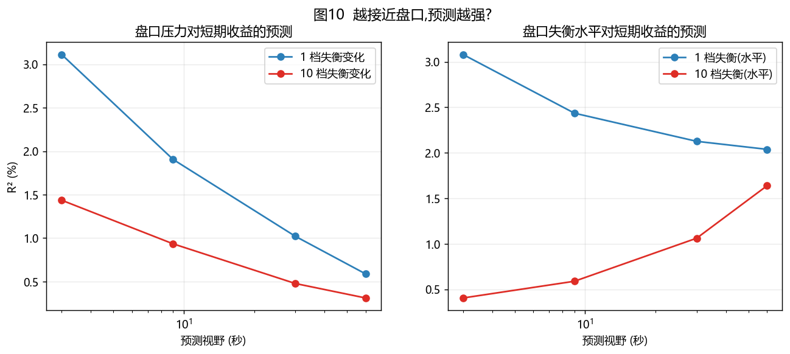

| 特征 | 3 秒 | 9 秒 | 30 秒 | 60 秒 |
| --- | ---: | ---: | ---: | ---: |
| **1 档失衡变化 Δ** | **3.11%** | 1.91% | 1.02% | 0.59% |
| 10 档失衡变化 Δ | 1.44% | 0.93% | 0.48% | 0.31% |
| **1 档失衡(水平)** | **3.08%** | 2.44% | 2.13% | 2.04% |
| 10 档失衡(水平) | 0.41% | 0.59% | 1.06% | **1.64%** |

**结论（分两层）**：

1. **对"变化"类信号：越靠近盘口越强**。买一失衡变化 3 秒 R²=3.11%，是十档（1.44%）的约 2 倍且衰减更快——**盘口压力是"快变量"**。
2. **对"水平"类信号：深档失衡在长视野反超**。十档失衡的 R² 随视野**上升**（0.41%→1.64%），而买一失衡几乎持平——**深档失衡刻画的是"慢变量"（潜在供需），在分钟级更有用**。

一句话：**预测短周期看买一，预测中周期看十档**。

---

## 10. 价差分解、Kyle λ、撤单-波动与拆单持续性

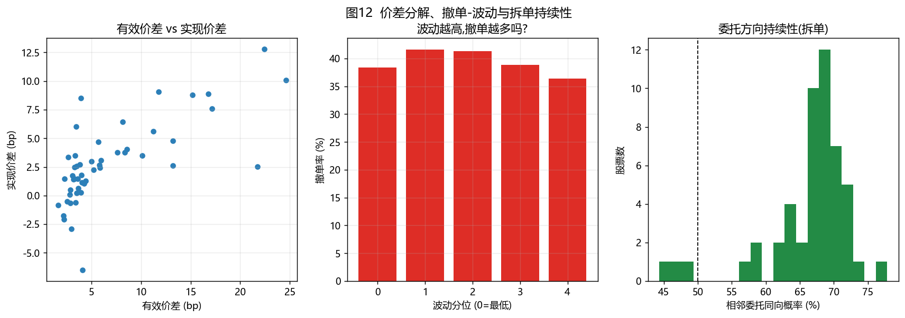

**（1）价差分解（5 分钟实现价差）**：把有效价差拆成"做市商赚到的实现价差"与"逆向选择/冲击"两部分：

| | 有效价差 | 实现价差 | 价格冲击 |
| --- | ---: | ---: | ---: |
| 均值 (bp) | 6.77 | 2.80 | **3.97** |
| 中位 (bp) | 4.01 | 2.52 | 3.12 |

**约 59% 的有效价差是价格冲击（逆向选择成本），41% 是流动性提供者的净收益。** 少数标的实现价差为负（最低 −6.5 bp），意味着这些股票的成交在 5 分钟内**继续朝同一方向运动**（知情/动量型流），做市反而亏钱。

**（2）Kyle λ**（|价格| 对净主动量的敏感度）：全样本中位 **28.4 bp / 百万股**，区间 2–474，跨股票差异达两个数量级——**低价股、深盘股每百万股推动价格的能力弱，高价股强**。

**（3）撤单率与波动的关系出乎意料**：

| 波动分位(每股票内) | 最低 | 2 | 3 | 4 | 最高 |
| --- | ---: | ---: | ---: | ---: | ---: |
| 撤单率 | 38.4% | **41.6%** | 41.4% | 38.9% | **36.4%** |

**"波动越高撤单越多"在本样本得不到支持**——撤单率在波动中位最高、最高波动反而略降。这提示撤单主要由**策略状态/价差位置**驱动，而非单纯的波动强度（至少在平静市、大盘股上如此）。

**（4）拆单与订单方向持续性**：相邻两笔新增委托方向相同的概率 **66.4%**（随机应为 50%），且**方向相同且价格相同的概率 35.2%**。显著高于随机的方向持续性，是**算法拆单 / 扫单**在逐笔层面的直接证据——大资金把母单切成同向、同价的小单连续投放。

---

## 11. 跨股票联动：高度同步 + 板块块状

用分钟中价收益构造相关矩阵与领先滞后结构（图 8）：

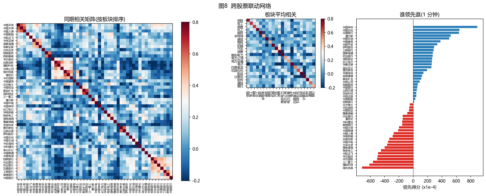

- **同步性极高**：50 只股票相对等权市场因子的最优领先/滞后，**39 只落在 0 分钟**，说明 1 分钟尺度上**找不到稳健的"谁领先谁"**（市场基本同涨同跌）。少数半导体（澜起、兆易、中微）显示 +4~5 分钟的"领先"，更可能是流动性/交易时段所致的伪相关。
- **板块块状相关**（日内分钟相关均值）：保险 **0.72**、券商 **0.65**、石油石化 **0.63**、通信 **0.59**、白酒食品 **0.55**、电力公用 0.50、有色 0.48、半导体 0.47、银行 0.47。
- **存在跨板块负相关**：煤炭电力（中国神华）对机械（−0.21）、消费（−0.24）、白酒（−0.01，弱）为负——**防御 vs 周期的跷跷板**在分钟尺度上可见。

---

## 12. 集合竞价、极端事件与快照一致性

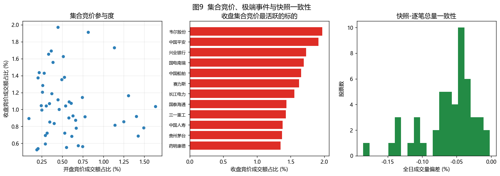

- **集合竞价参与度**：开盘竞价占全日成交额 **0.59%**，收盘竞价 **1.06%**（约为开盘的 1.8 倍）。收盘竞价最活跃的是韦尔股份、中国平安、兴业银行、国电南瑞、中国船舶（占各自成交额 1.65%–1.97%）。**尾盘集中调仓的痕迹明显。**
- **极端事件**：本样本**无涨跌停**，最大日内涨幅仅 +3.68%（澜起科技），属"平静日"。这解释了为何撤单率、冲击等指标整体温和——**若换到高波动日，撤单风暴与流动性枯竭的尾部特征会显著增强**。
- **快照—逐笔一致性**：全日累计成交量（快照口径）/ 逐笔成交求和 = **99.94%**（逐股 99.81%–99.998%）。区间级存在约 0.15–1.0 秒的行情网关对齐偏移，导致逐 3 秒比对时 ~40% 区间完全一致——**这是时点偏移而非数据错误**（与"交易所复现"任务独立得到的结论一致）。

---

## 13. 方法、复现与局限

### 复现
```
python s01_overview.py         # 样本量、日内时钟、图1
python s02_liquidity.py        # 快照面板 + 逐股流动性与有效价差 (snap_panel.parquet)
python s03_intraday.py         # 日内 U 形，图2
python s04_orderflow.py        # OFI 与 3/9/30/60 秒预测，图3
python s05_impact.py           # 大单事件研究与永久/临时冲击，图4
python s06_orderbook.py        # 订单簿形态、失衡、整数偏好，图5
python s07_orders.py           # 委托行为与撤单战术，图6
python s08_trades.py           # 成交特征、VPIN、1s 预测，图7
python s09_network.py          # 跨股票相关与领先滞后，图8
python s10_special.py          # 集合竞价、涨跌停、快照一致性，图9
python s11_depth_pred.py       # 盘口距离 vs 预测力，图10
python s12_summary.py          # 横截面风格化事实与控制表，图11 + 12_master_table.csv
python s13_dashboard.py        # 生成交互式 out/micro_dashboard.html
python s14_extra.py            # 价差分解/Kyle λ/撤单-波动/拆单，图12
```
中间产物：`out/snap_panel.parquet`（239,738 行清洗后快照面板）、`out/vpin.parquet`；所有表在 `out/tables/`。
交互式看板：`out/micro_dashboard.html`（双击即可打开，内含逐股中价/价差/成交量曲线 + 可排序指标表 + 全部图表）。

### 关键方法
- **OFI**：Cont, Kukanov & Stoikov (2014)。
- **有效价差 / 实现价差**：以事件时点前一快照的中间价为基准。
- **实现价差分解**：实现价差 = 有效价差 − 价格冲击，冲击用 5 分钟后中间价度量。
- **Kyle λ**：分钟收益（bp）对分钟净主动量（百万股）回归的斜率。
- **VPIN**：成交量分成 50 个等量桶，桶内 |买−卖|/总量。
- **大单事件研究**：以事件前一刻中间价为基准，跨事件平均；同时报告均值与中位以揭示重尾。
- **领先滞后**：分钟收益的滞后互相关 + 相对等权市场因子的最优滞后。

### 局限
1. **只覆盖"进入订单簿"的委托**：上交所逐笔委托不含"下单即全成"的委托，因此"主动单占比""委托规模"等**偏低估计**；但撤单语义、订单簿形态不受影响。
2. **3 秒快照粒度**：所有"秒级"预测实际最小步长为 3 秒；1 秒分析用成交价序列近似。
3. **单日样本**：跨股票结论稳健，但"日内 U 形""VPIN 衰减"等时间维结论需多日验证。
4. **平静日偏差**：无涨跌停、波动温和，尾部事件（撤单风暴、流动性枯竭）未能覆盖。
5. **板块标签为人工映射**，个别标的（如生益科技归"电子"）归类可能与其他口径不同。

### 可继续深入的方向
- 用**订单号关联 / 成交量-委托量不匹配**识别**冰山单与拆单**（本样本已有 `OrderOriNo` 可与成交对手方对齐）。
- 用 **Hawkes 过程**刻画撤单/成交的自我激发（本样本撤单自相关低，但跨事件激发待测）。
- 用 **订单簿特征 + 机器学习**做更细粒度方向/波动预测，并做特征重要性（盘口失衡、深档斜率、撤单强度）。
- 把本文的快照面板与"交易所复现"的**还原订单簿**对接，做**十档→逐笔一致性**与**隐藏流动性**估计。

---

*本报告由微观结构分析脚本自动生成，数据为 2026-09-23 上交所 Level-2 上证 50 样本。*
